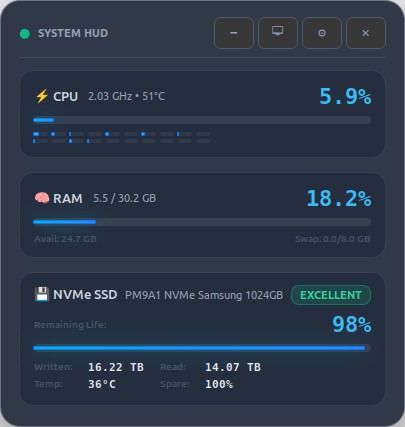
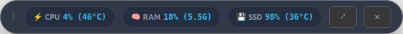

# Desktop Stat Monitor Overlay

[](LICENSE)
[](https://www.python.org/)
[](https://www.gtk.org/)

A sleek, transparent glassmorphic system monitor designed to float seamlessly over your desktop background on Linux (Ubuntu GNOME / Wayland / X11).

Built with Python 3, PyGObject (GTK 3), and UDisks2 DBus telemetry.

---

## Screenshots

| Dashboard Mode | Compact Pill Mode |
|:-:|:-:|
|  |  |

---

## Highlights & Metrics

- **⚡ CPU Telemetry**:
  - Live overall CPU usage percentage
  - Real-time CPU clock frequency (GHz)
  - CPU package & core temperature (°C)
  - Individual mini visual bars for all CPU cores (expandable/collapsible)
- **🧠 Memory (RAM) Telemetry**:
  - Live RAM usage percentage with glowing progress bar
  - Exact Used and Total memory (e.g., `13.4 / 30.2 GB`)
  - Available free memory and Swap partition statistics
- **💾 NVMe SSD Health & Remaining Life**:
  - **Remaining Life Left %** (calculated from NVMe wear percentage)
  - Color-coded Health Status Badge (`EXCELLENT`, `GOOD`, `WARNING`, `CRITICAL`)
  - Total Terabytes Written (TBW) & Total Terabytes Read (TBR)
  - NVMe Controller / Drive Temperature (°C)
  - Available Spare Capacity % and Threshold
  - Power-On Runtime Hours
  - **Zero Sudo Required**: Queries NVMe telemetry directly via standard system `UDisks2` D-Bus.

---

## Visual Design & Modes

1. **Full Dashboard Mode**:
   - Comprehensive glassmorphic card with translucent slate background and matching glowing light blue indicators.
2. **Compact Floating Pill Mode**:
   - An ultra-minimal horizontal pill bar (`⚡ CPU • 🧠 RAM • 💾 SSD`) designed to sit unobtrusively on any corner of your wallpaper.
3. **Desktop Pinning vs HUD Overlay**:
   - **Pin to Desktop**: Sits on the wallpaper underneath normal open application windows.
   - **Always on Top (HUD)**: Floats above windows for monitoring during gaming or benchmarking.
4. **Customizable Translucency**:
   - **0% Clear Glass** (Completely Transparent background - metrics float on wallpaper)
   - 20% Ghost
   - 50% Aero Glass
   - 75% Dark Glass (Default)
   - 90% High Contrast Solid

---

## Controls & Hotkeys

| Action | Control / Shortcut |
|---|---|
| **Move / Reposition** | Left-click and drag anywhere on the overlay |
| **Context Menu & Settings** | Right-click anywhere on the overlay |
| **Toggle Dashboard / Compact** | `M` or `Tab` (or click `🗕` / `⤢`) |
| **Toggle Pin to Desktop / HUD** | `P` (or click `📌` / `🖵`) |
| **Lock / Unlock Position** | `L` (prevents accidental dragging) |
| **Adjust Opacity** | `0` (0% Clear Glass), `1` (20%), `2` (50%), `3` (75%), `4` (90%) |
| **Close / Exit** | `Esc` or `Q` (or click `✕`) |

---

## Installation & Deployment to Another Machine

### Option A: Debian Package (.deb) — Recommended for Ubuntu / Debian / Pop!_OS / Mint

The easiest way to install on another laptop is using the generated `.deb` package. APT will automatically download and install all system dependencies:

1. **Build the `.deb` package (if not already built)**:
   ```bash
   ./build_deb.sh
   ```
   *(This outputs `dist/stat-monitor_1.0.0_all.deb` and `dist/stat-monitor.deb`)*

2. **Copy the `.deb` to the other laptop**:
   ```bash
   scp dist/stat-monitor.deb user@other-laptop:~/
   ```

3. **Install with APT on the other laptop**:
   ```bash
   sudo apt update
   sudo apt install ./stat-monitor.deb
   ```
   *APT will automatically resolve and install `python3-gi`, `gir1.2-gtk-3.0`, `python3-psutil`, and `udisks2`!*

4. **Run anywhere**:
   - Run `stat-monitor` (or `stat-monitor --bg`) in any terminal
   - Or launch **"Stat Monitor Overlay"** from the GNOME application launcher.

---

### Option B: Manual Folder Deployment (Any Linux Distro)

#### 1. Prerequisites / System Packages
Install the required system packages for Python 3, PyGObject (GTK 3), psutil, and UDisks2:

- **Ubuntu / Debian / Linux Mint**:
  ```bash
  sudo apt update
  sudo apt install -y python3 python3-gi python3-gi-cairo gir1.2-gtk-3.0 python3-psutil udisks2
  ```

- **Fedora / RHEL**:
  ```bash
  sudo dnf install -y python3 python3-gobject gtk3 python3-psutil udisks2
  ```

- **Arch Linux / Manjaro**:
  ```bash
  sudo pacman -S python python-gobject gtk3 python-psutil udisks2
  ```

*(Alternatively with pip: `pip3 install -r requirements.txt`)*

### 2. Copy the Files to the New Machine
You can transfer this folder via `scp`, `rsync`, flash drive, or git repository:
```bash
# Example via rsync (from the current laptop):
rsync -avz --exclude='__pycache__' ~/stat_monitor user@other-laptop:~/stat_monitor
```

### 3. Setup Desktop Launcher & Permissions
On the new laptop, navigate to the folder and make scripts executable:
```bash
cd ~/stat_monitor
chmod +x run.sh install_desktop_entry.sh main.py
./install_desktop_entry.sh            # Installs to Application Menu
# or
./install_desktop_entry.sh --autostart # Installs and autostarts on login
```

---

## How to Run

### 1. Launch in Foreground
```bash
./run.sh
```

### 2. Launch in Background (Daemon)
```bash
./run.sh --bg
```
*(To terminate background monitor: right-click overlay -> Quit, or `killall python3 main.py`)*

### 3. CLI Options
```bash
./run.sh --clear             # Launch with 0% Clear Glass (completely transparent background)
./run.sh --compact           # Start directly in compact pill bar mode
./run.sh --dashboard         # Start directly in full dashboard mode
./run.sh --on-top            # Float above other windows
./run.sh --desktop           # Pin to desktop background below windows
./run.sh --opacity 0.0       # Set custom background opacity (0.0 - 0.95)
./run.sh --refresh 500       # Set refresh rate in ms (e.g. 500ms or 1000ms)
```

### 4. Enable Autostart on Login
```bash
./install_desktop_entry.sh --autostart
```
You can also launch it anytime from the GNOME application launcher by typing **"Stat Monitor Overlay"**.

---

## Configuration

Settings (window X/Y coordinates, mode, opacity, placement preference) are automatically persisted to:
```
~/.config/stat_monitor/config.json
```
Whenever you drag the window or change settings, they are saved and restored on next launch.

---

## Author

Created by **[Erek Niemyjski](https://github.com/neuraworks-erek-niemyjski)**.

Contributions, bug reports, and feature requests are welcome!

---

## Credits & Acknowledgements

The application architecture, UI layout, glassmorphic CSS theme, and monitor logic are an original design built specifically for this project. It is built upon and acknowledges the foundational work of the following upstream open-source projects and specifications:

- **[freedesktop.org UDisks2](https://github.com/storaged-project/udisks)**:
  - NVMe SMART health attributes, drive telemetry, and non-root hardware inspection leverage the `org.freedesktop.UDisks2.NVMe.Controller` D-Bus interface created and maintained by the UDisks2 / Red Hat storage engineering team.
  - Reference: [UDisks2 NVMe Controller API Documentation](https://storaged.org/doc/udisks2-api/latest/gdbus-org.freedesktop.UDisks2.NVMe.Controller.html)
- **[NVM Express™ (NVMe) Workgroup](https://nvmexpress.org)**:
  - SSD endurance calculations, spare block capacity thresholds, and telemetry byte conversions adhere to the official NVM Express Base Specification.
- **[psutil](https://github.com/giampaolo/psutil)**:
  - CPU utilization, per-core metrics, core clock frequencies, thermal sensors, and memory statistics are powered by `psutil`, created by Giampaolo Rodola and the open-source community (BSD-3-Clause).
- **[GNOME / PyGObject & GTK 3](https://pygobject.gnome.org)**:
  - Native window compositing, RGBA transparency, Wayland/X11 surface coordination, and CSS styling engine are provided by the GNOME Foundation and PyGObject contributors (LGPL-2.1+).

---

## License

This project is open-source under the [MIT License](LICENSE).

